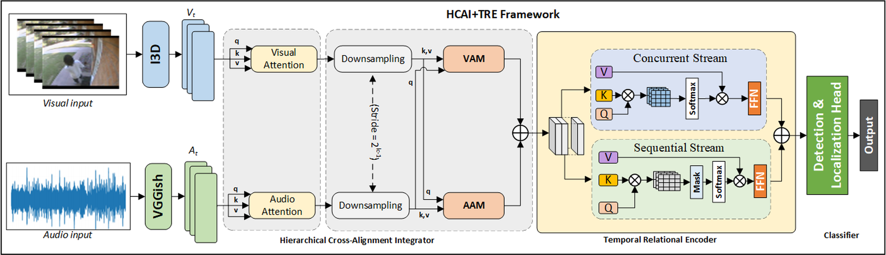

# HCATRE-AVAD

Official implementation of **HCATRE-AVAD: Hierarchical Cross-Alignment and Temporal Relational Encoding for Weakly Supervised Audio-Visual Anomaly Detection**.

## Overview

HCATRE-AVAD is a weakly supervised audio-visual anomaly detection framework designed to address temporal misalignment between audio and visual streams while improving fine-grained anomaly localization.

The framework introduces:

* **Hierarchical Cross-Alignment Integrator (HCAI)** for multi-scale audio-visual synchronization.
* **Temporal Relational Encoder (TRE)** for concurrent and sequential temporal reasoning.
* **Contrastive Alignment Loss (CAL)** for cross-modal consistency.
* **Top-k Multiple Instance Learning (MIL)** for training using only video-level labels.

The model achieves state-of-the-art performance on the XD-Violence benchmark and competitive results on UCF-Crime and ShanghaiTech datasets.

---

## Framework

<p align="center">
  
</p>

The proposed framework consists of:

1. Audio-Visual Feature Extraction
2. Hierarchical Cross-Alignment Integrator (HCAI)
3. Temporal Relational Encoder (TRE)
4. Weakly Supervised Anomaly Scoring Head
5. Contrastive Alignment Optimization

---

## Key Contributions

* First weakly supervised audio-visual anomaly detection framework with hierarchical cross-modal alignment.
* Multi-scale synchronization of asynchronous audio and visual streams.
* Dual-path temporal reasoning for anomaly progression and co-occurrence modeling.
* Contrastive alignment learning for enhanced cross-modal consistency.
* Fine-grained anomaly localization under weak supervision.

---

## Performance

### XD-Violence

| Method                       | Modality     | AP (%)    |
| ---------------------------- | ------------ | --------- |
| AVCL                         | Audio-Visual | 81.11     |
| AVCL (MACIL-SD)              | Audio-Visual | 83.98     |
| CFA-HLGAtt                   | Audio-Visual | 86.34     |
| **HCATRE-AVAD (Audio-RGB)**  | Audio-Visual | **95.75** |
| **HCATRE-AVAD (Audio-Flow)** | Audio-Visual | **93.55** |

---

### UCF-Crime

| Method          | AUC (%)   |
| --------------- | ----------|
| RTFM            | 81.20     |
| MIST            | 82.30     |
| REWARD          | 87.48     |
| **HCATRE-AVAD** | **82.47** |

---

### ShanghaiTech

| Method      | AUC (%) |
| ----------- | ------- |
| MIST        | 94.83   |
| S3R         | 97.39   |
| MSGRU-TRF   | 97.67   |
| HCATRE-AVAD | 76.81   |

---

## Datasets

### XD-Violence

Large-scale audio-visual anomaly detection benchmark.

* Videos: 4,754
* Duration: 217 Hours
* Labels: Video-Level
* Modality: Audio + Visual

Dataset:
https://roc-ng.github.io/XD-Violence/

---

### UCF-Crime

Large-scale surveillance anomaly detection benchmark.

* Videos: 1,900
* Duration: 128 Hours
* Labels: Video-Level
* Modality: Visual

Dataset:
https://www.crcv.ucf.edu/projects/real-world/

---

### ShanghaiTech

Frame-level anomaly detection benchmark.

* Videos: 437
* Duration: 317 Hours
* Labels: Frame-Level
* Modality: Visual

Dataset:
https://svip-lab.github.io/dataset/campus_dataset.html

---

## Feature Extraction

### Visual Features

* I3D (Inflated 3D ConvNet)
* Pretrained on Kinetics

### Audio Features

* VGGish
* Pretrained on AudioSet

---

## Project Structure

```text
HCATRE-AVAD/
│
├── datasets/
│   ├── XD_Violence/
│   ├── UCF_Crime/
│   └── ShanghaiTech/
│
├── models/
│   ├── hcai.py
│   ├── tre.py
│   ├── anomaly_head.py
│   └── hcatre_avad.py
│
├── losses/
│   ├── mil_loss.py
│   └── contrastive_alignment_loss.py
│
├── feature_extraction/
│   ├── extract_i3d.py
│   └── extract_vggish.py
│
├── train.py
├── test.py
├── inference.py
└── README.md
```

---

## Training

```bash
python train.py
```

---

## Evaluation

```bash
python test.py
```

---

## Inference

```bash
python inference.py
```

---

## Qualitative Results

The model provides:

* Frame-level anomaly scores
* Audio attention visualization
* Visual attention visualization
* Cross-modal alignment maps
* Fine-grained anomaly localization

<p align="center">
  
</p>

---

## Citation

```bibtex
@article{abiew2026hcatre,
  title={HCATRE-AVAD: Hierarchical Cross-Alignment and Temporal Relational Encoding for Weakly Supervised Audio-Visual Anomaly Detection},
  author={Abiew, Nuku Atta Kordzo and Gao, Lijian and Mensah, Godbless and Dong, Wenlong and Mao, Qirong},
  journal={Image and Vision Computing},
  year={2026},
  doi={10.1016/j.imavis.2026.106072}
}
```

---

## Acknowledgement

This work was conducted at:

* School of Computer Science and Communication Engineering, Jiangsu University, China
* Ghana Communication Technology University, Ghana
* Koforidua Technical University, Ghana

---

## Status

🚀 Paper Accepted in Image and Vision Computing (IVC)

📄 DOI: 10.1016/j.imavis.2026.106072

💻 Source code and pretrained models will be released upon publication.
